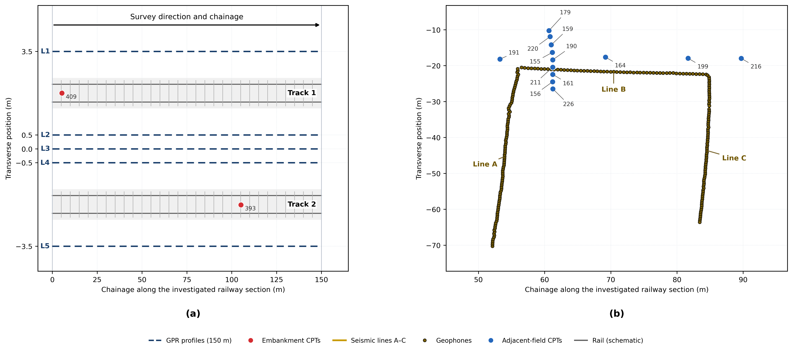
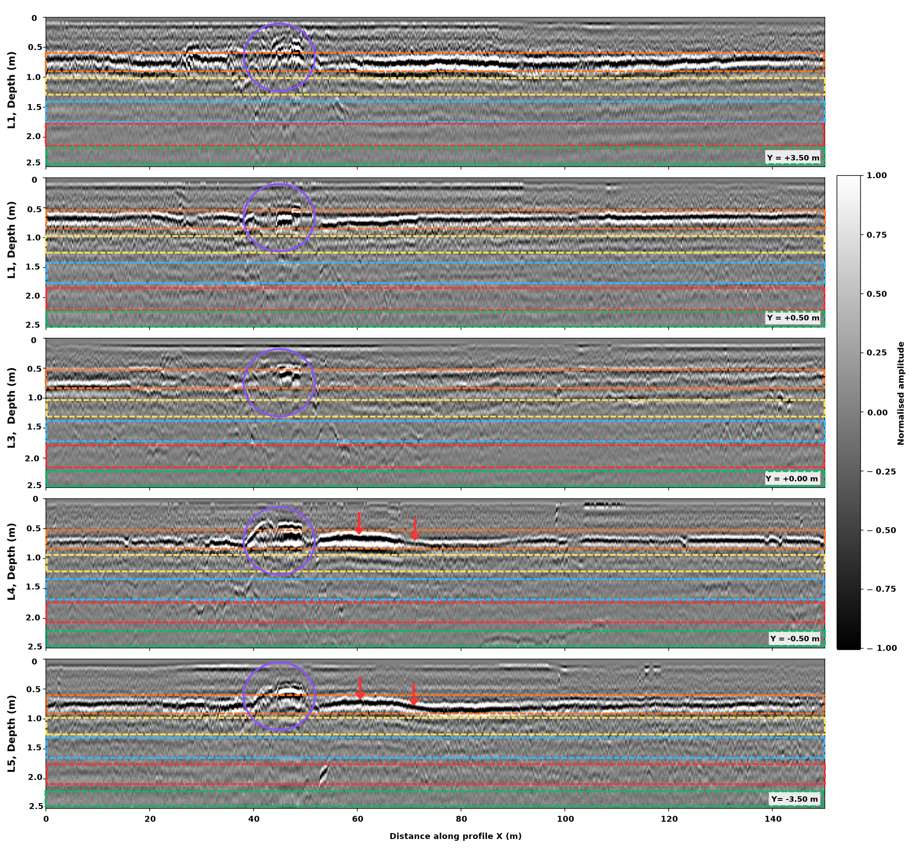
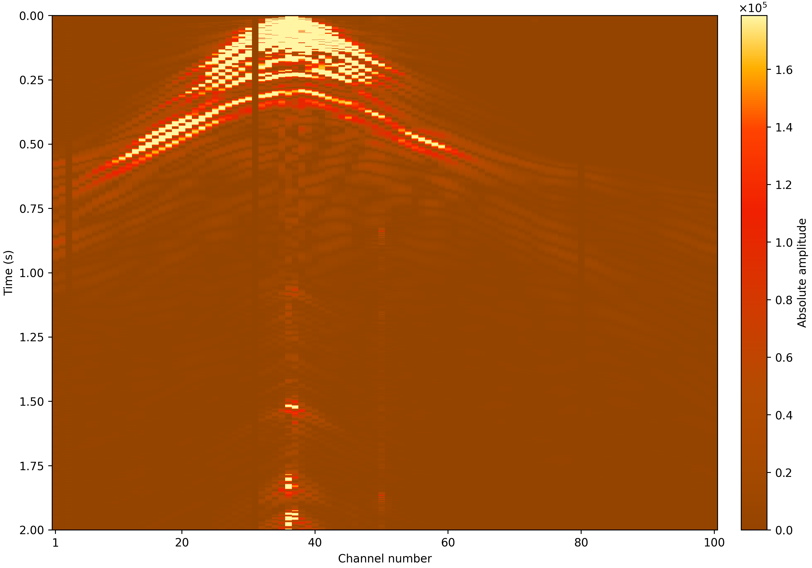
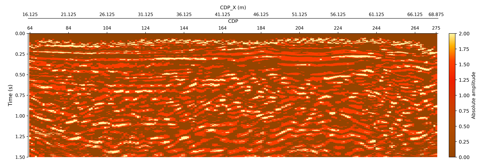
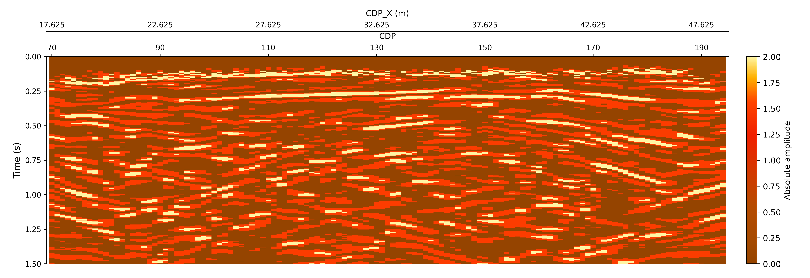
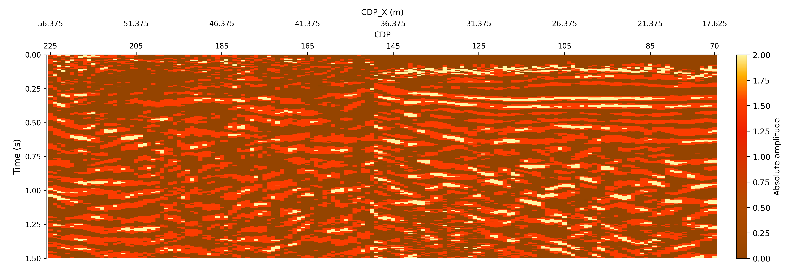

# Railway_Embankment_GPR_SHWave_CPT
Integrated GPR, SH-wave seismic reflection, and CPT datasets for railway embankment and soft-ground characterization.
The repository contains the processed datasets, supporting files, and documentation required to facilitate reproducibility and verification of the reported results.

---

## Associated publication

This repository accompanies the manuscript:

**Integrated GPR, SH-wave seismic reflection, and CPT investigation for railway embankment and soft-ground characterization**

submitted to the *Transportation Geotechnics*.

---

## Authors

Sepideh Harajchi
Ranajit Ghose
Deyan Draganov
Jan Thorbecke
Evert Slob  

---

## Contact
**Corresponding author: Sepideh Harajchi**

- [s.harajchi@tudelft.nl](mailto:s.harajchi@tudelft.nl)  
- [sepideh.harajchii@gmail.com](mailto:sepideh.harajchii@gmail.com)  

---

## Repository structure

### 01_Study_Area

This folder contains figures illustrating the study area, field investigation layout, and railway infrastructure.

- **Figure 1:** Geographical location of the investigated railway section along the Delft–Schiedam railway corridor, the Netherlands.
- **Figure 2:** Field investigation layout showing the geophysical survey lines and available geotechnical investigation locations.
- **Figure 3:** Field photograph of the railway track and surrounding investigation area.

#### Study area figures

  

<em>Figure 1. Location of the study area along the Delft–Schiedam railway corridor, the Netherlands.</em>

  

<em>Figure 2. Layout of the geophysical surveys and geotechnical investigations.</em>

  

<em>Figure 3. Field photograph showing the railway track and surrounding investigation area.</em>

### 02_GPR

This folder contains the processed ground-penetrating radar (GPR) results used to characterize the railway embankment
and underlying supporting soils.

Five longitudinal GPR profiles (L1–L5) were acquired at different lateral positions relative to the railway track.

The processing workflow includes time-zero correction, dewow filtering, and average-trace subtraction.
A time-power gain (exponent = 1) was applied only for radargram visualization.

An effective electromagnetic wave velocity of 0.14 m/ns was adopted for approximate time-to-depth conversion.

#### Figure 4 — GPR interpretation

  

  <em>Figure 4. Processed GPR radargrams for profiles
  L1–L5, showing interpreted subsurface horizons,
  lateral variations in reflector geometry, and
  localized diffraction features.</em>

The interpreted reflections provide information on
subsurface layering and spatial heterogeneity.
Localized reflector variations may indicate
subsurface disturbances requiring further investigation.

### 03_Seismic

This folder contains raw and processed SH-wave seismic reflection
datasets, seismic sections, and Dix-derived interval shear-wave
velocity (Vs) parameters for Lines A, B, and C.

The processing includes CMP sorting, NMO correction, stacking,
and T–K migration. Interval velocities were estimated using
the Dix equation.

The folder contains two subfolders:

- **`01_final_outputs`** — Raw shot gather, processed seismic
  sections (Figures 5 and 6), and SEG-Y datasets.
- **`02_dix_outputs`** — Dix-derived interval velocity parameters.

#### 01_final_outputs

##### Figure 5 — Raw SH-wave seismic shot gather

  

Raw SH-wave seismic shot gather acquired along Line A, illustrating the recorded wavefield before processing.

##### Figure 6 — Processed SH-wave seismic reflection sections

  

<em>(a) Line A</em>

  

<em>(b) Line B</em>

  

<em>(c) Line C</em>

Figure 6 presents the processed SH-wave seismic reflection sections, highlighting subsurface layering, reflector
continuity, and lateral heterogeneity.

##### SEG-Y datasets

- `Line1_rawshot_sourceX35p5m.segy` — Raw shot gather, Line A.
- `LineA_stacked.segy` — Stacked seismic data, Line A.
- `LineB_stacked.segy` — Stacked seismic data, Line B.
- `LineC_stacked.segy` — Stacked seismic data, Line C.

#### 02_dix_outputs

- **`dix_layer_parameters.csv`** — Dix-derived interval
  shear-wave velocities and layer parameters for the investigated seismic lines.

[View Dix-derived velocity parameters](03_Seismic/02_dix_outputs/dix_layer_parameters.csv)

