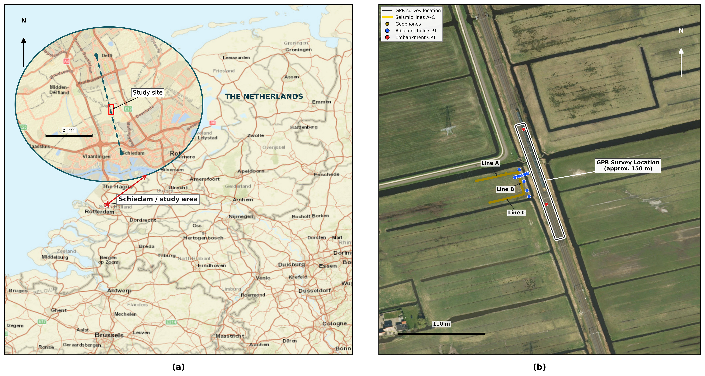
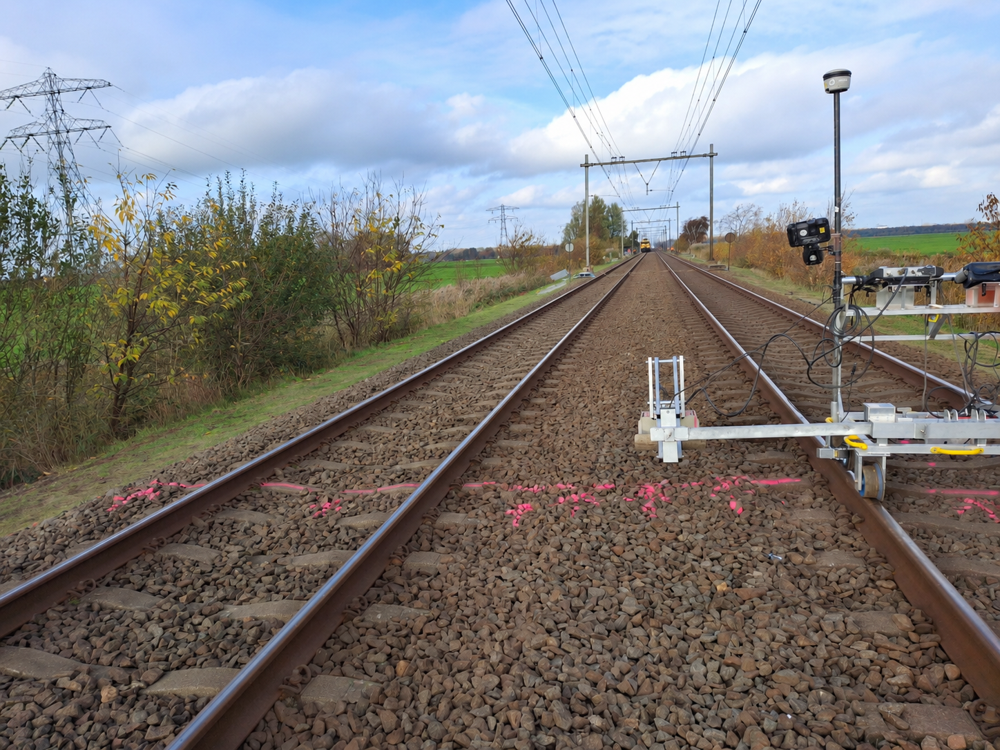
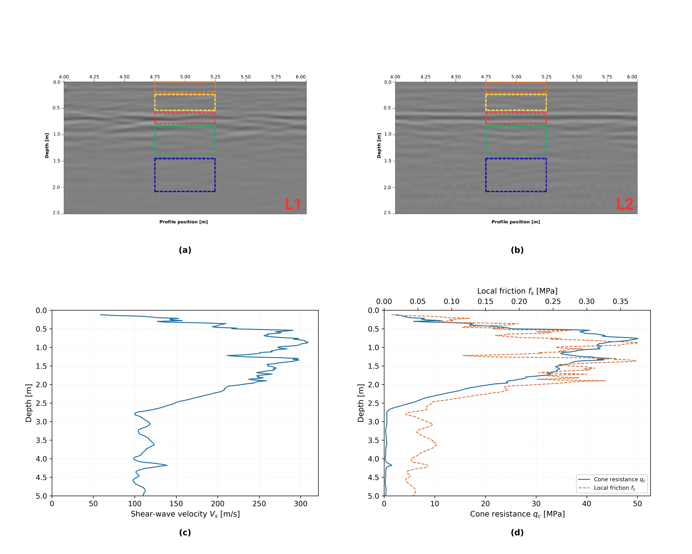
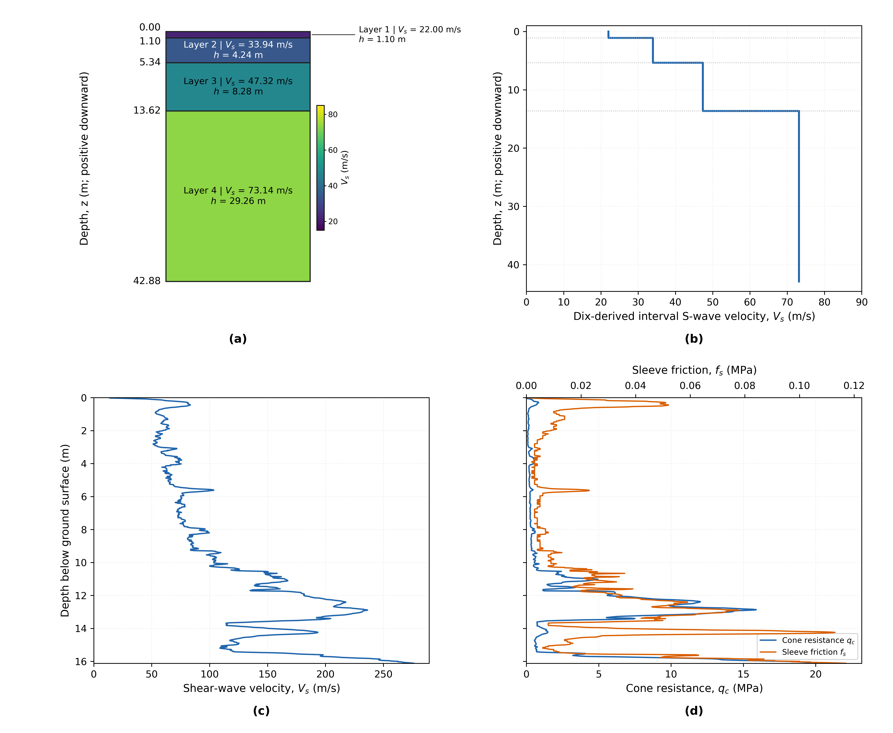
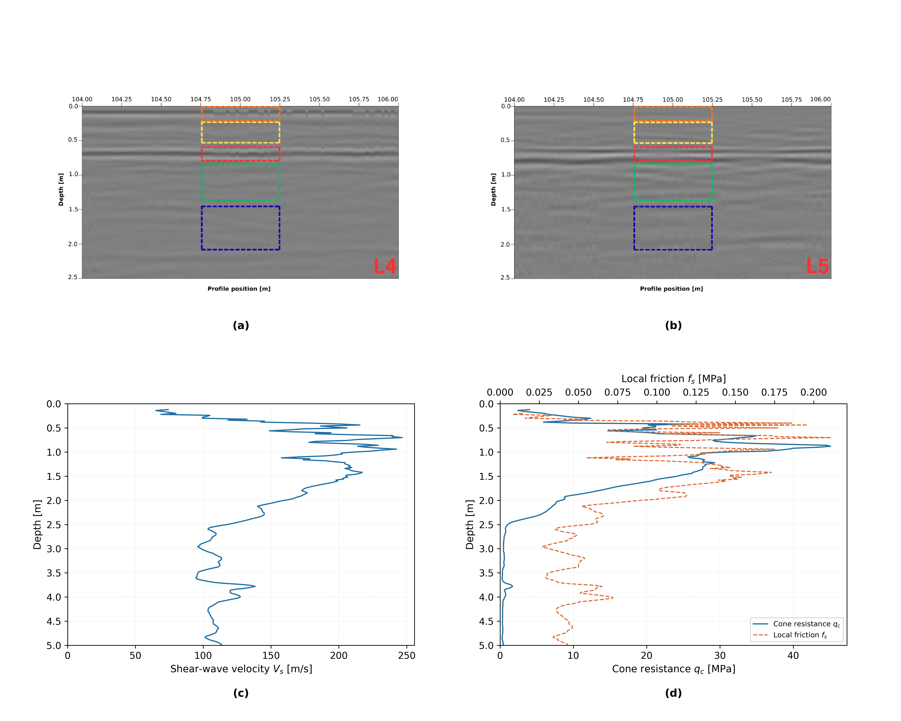
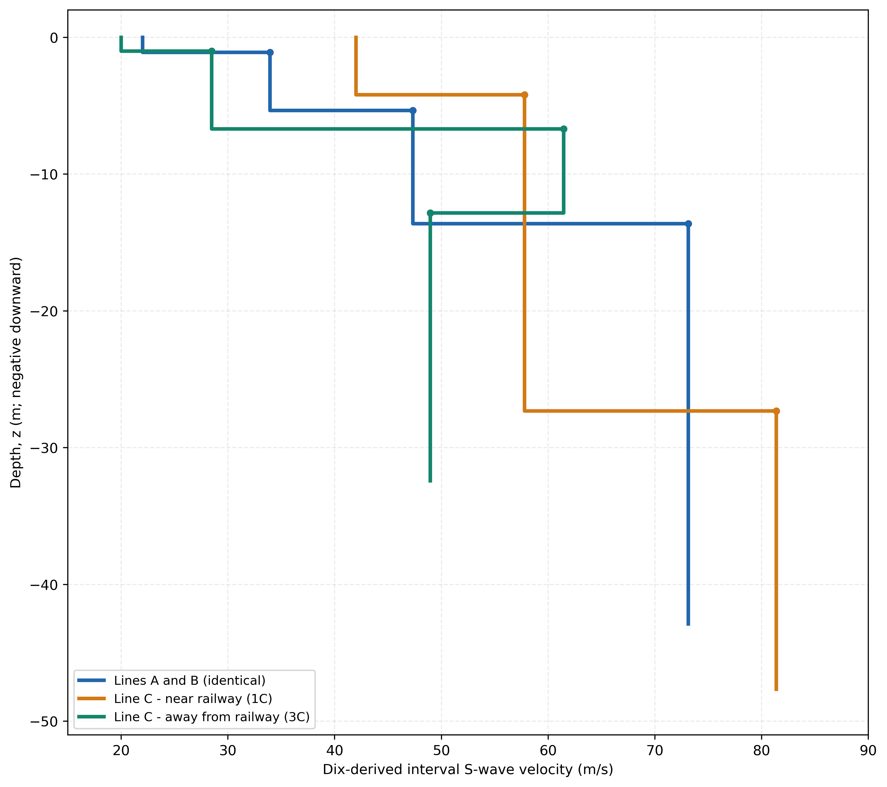
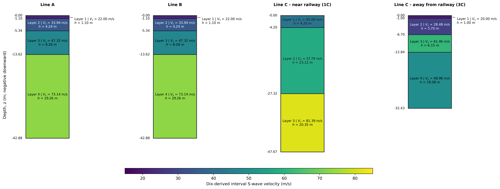

# Railway_Embankment_GPR_SHWave_CPT

Integrated GPR, SH-wave seismic reflection, and CPT datasets for railway embankment and soft-ground characterization. This repository provides processed datasets, figures, and supporting files for interpreting and verifying the reported results.

---

## Associated publication

**Integrated GPR, SH-wave seismic reflection, and CPT investigation for railway embankment and soft-ground characterization**

Manuscript submitted to the *Transportation Geotechnics*. 

---

## Authors

Sepideh Harajchi  
Ranajit Ghose  
Deyan Draganov  
Jan Thorbecke  
Evert Slob  

Department of Geoscience and Engineering  
Delft University of Technology, the Netherlands

---

## Contact

**Corresponding author:** Sepideh Harajchi

- [s.harajchi@tudelft.nl](mailto:s.harajchi@tudelft.nl)
- [sepideh.harajchii@gmail.com](mailto:sepideh.harajchii@gmail.com)

---

## Repository structure

### 01_Study_Area

Study-area location, survey layout, and field photographs.

<em>Figure 1. Location of the investigated railway section along the Delft–Schiedam railway corridor, the Netherlands.</em>

<em>Figure 2. Field investigation layout showing the geophysical survey lines and available geotechnical investigation locations.</em>

<em>Figure 3. Field photograph showing the railway track and surrounding investigation area.</em>

### 02_GPR

Processed GPR radargrams from five longitudinal profiles (L1–L5), acquired at different lateral positions relative to the railway. Processing includes time-zero correction, dewow filtering, and average-trace subtraction. Time-power gain (exponent 1) was used **for visualization only**. An effective electromagnetic velocity of **0.14 m/ns** was used for approximate time-to-depth conversion.

<em>Figure 4. Processed GPR radargrams for profiles L1–L5, showing interpreted subsurface horizons, lateral changes in reflector geometry, and localized diffraction features.</em>

### 03_Seismic

Raw and processed SH-wave seismic reflection data for Lines A, B, and C. Processing includes CMP sorting, NMO correction, stacking, and T–K migration; interval shear-wave velocities were estimated using the Dix equation.

The folder contains **`01_final_outputs`** (seismic figures and SEG-Y files) and **`02_dix_outputs`** (Dix-derived layer parameters).

#### 01_final_outputs

<em>Figure 5. Raw SH-wave seismic shot gather acquired along Line A, showing the recorded wavefield before reflection processing.</em>

<em>Figure 6(a). Processed SH-wave seismic reflection section along Line A.</em>

<em>Figure 6(b). Processed SH-wave seismic reflection section along Line B.</em>

<em>Figure 6(c). Processed SH-wave seismic reflection section along Line C.</em>

**SEG-Y datasets:**

- `Line1_rawshot_sourceX35p5m.segy` — Raw shot gather, Line A.
- `LineA_stacked.segy` — Stacked seismic data, Line A.
- `LineB_stacked.segy` — Stacked seismic data, Line B.
- `LineC_stacked.segy` — Stacked seismic data, Line C.

#### 02_dix_outputs

- [`dix_layer_parameters.csv`](03_Seismic/02_dix_outputs/dix_layer_parameters.csv) — Dix-derived interval shear-wave velocities and associated layer parameters.

### 04_CPTs

CPT measurements and derived parameters for **15 soundings**: 13 in adjacent ground and two in the railway embankment (CPT 409 and CPT 393). Parameters include cone resistance (qc), sleeve friction (fs), friction ratio (Rf), and empirically estimated shear-wave velocity (Vs).

**Databases:**

- [`CPT_Master_Database.xlsx`](04_CPTs/CPT_Master_Database.xlsx) — Consolidated CPT measurements.
- [`CPT_Embankment_Master_Database.xlsx`](04_CPTs/CPT_Embankment_Master_Database.xlsx) — Railway-embankment CPT measurements.

#### Outputs

The `Outputs` subfolder contains CPT profiles referenced to the Dutch vertical datum (NAP).

<em>CPT output 1. Cone resistance (qc) profiles for the investigated soundings, plotted relative to NAP.</em>

<em>CPT output 2. Sleeve friction (fs) profiles for the investigated soundings, plotted relative to NAP.</em>

<em>CPT output 3. Friction ratio (Rf) profiles for the investigated soundings, plotted relative to NAP.</em>

<em>CPT output 4. CPT-derived shear-wave velocity (Vs) profiles, estimated using the empirical relationship of Robertson (2009), plotted relative to NAP.</em>

### 05_Integration

Figures comparing geophysical interpretations with geotechnical information, together with Dix-derived SH-wave velocity models.

<em>Figure 8. Integrated geophysical and geotechnical comparison. [Confirm the exact panel descriptions against the manuscript caption.]</em>

<em>Figure 9. Comparison of geophysical and CPT-derived subsurface information. [Confirm the exact panel descriptions against the manuscript caption.]</em>

<em>Figure 10. Comparison of GPR radargrams from (a) L4 and (b) L5, extracted within ±1 m of the CPT location, with (c) CPT-derived shear-wave velocity (Vs) and (d) cone resistance (qc) and sleeve friction (fs).</em>

<em>Figure 11(a). Dix-derived interval SH-wave velocity–depth profiles for Lines A, B, and C, including the receiver configurations along Line C.</em>

<em>Figure 11(b). Layered Dix-derived SH-wave velocity models showing estimated velocities and corresponding layer thicknesses.</em>

The integrated interpretation constrains subsurface layering and lateral heterogeneity and identifies potential anomalies for further geotechnical investigation.

---

## Notes on data interpretation

GPR depths are approximate because a single effective electromagnetic velocity was used for a heterogeneous subsurface. CPT-derived Vs estimates are empirical; seismic interval velocities depend on the assumptions of the velocity analysis. Interpretations should therefore be considered alongside the available geotechnical evidence.
